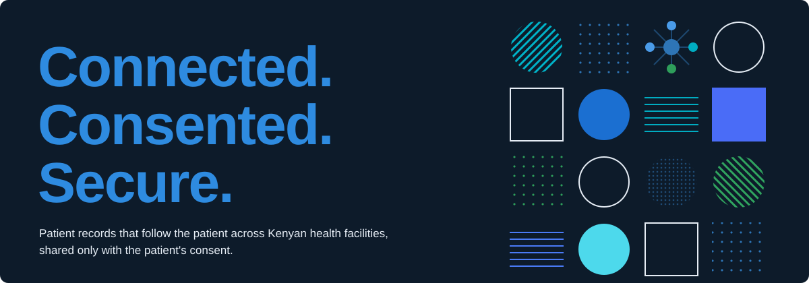

  

## UDICON Healthcare

**UDICON** (Universal Data Integration and Collaboration Network) connects hospitals, clinics,
laboratories and pharmacies in Nairobi, so a patient's medical history can follow them from one
facility to the next, and only when the patient says so.

Today a patient who changes clinic often starts again from nothing: repeated tests, missing
allergies, lost prescriptions. UDICON gives each patient one record across the facilities they
use, with the patient in control of who sees it.

### What we are building

- **One patient, one record**: a master patient index matches people across facilities using their
  national ID or NHIF number.
- **The patient owns consent**: patients choose whether their record is shared, and can withdraw
  that choice at any time, with immediate effect.
- **Built on open standards**: clinical data is stored as HL7 FHIR R4, so no facility is locked in.
- **Privacy by design**: every access is recorded in an audit trail that cannot be edited, every
  clinician signs in with two-factor authentication, and data is handled under the Kenya Data
  Protection Act, 2019.
- **Paper to digital**: a document digitization service turns a clinic's paper records into
  structured digital records.

### Where we are

UDICON is in development. Our pilot work uses **synthetic data only**. We will not process real
patient data until our registration with the Office of the Data Protection Commissioner and our
security checks are complete.

### Team

- **Marion Wambura**: Founder and CEO
- **Alexander Somba**: Co-Founder and CTO

Our source code is private. © UDICON.
